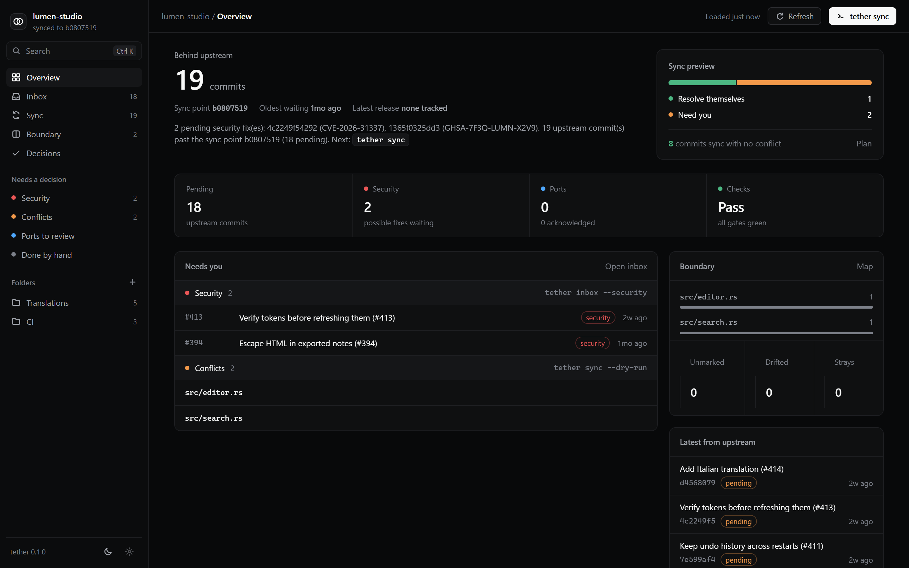
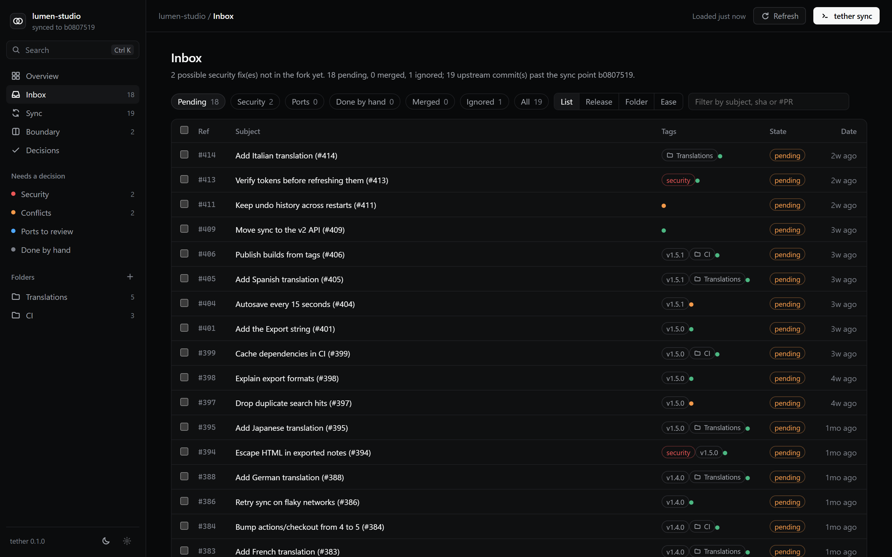
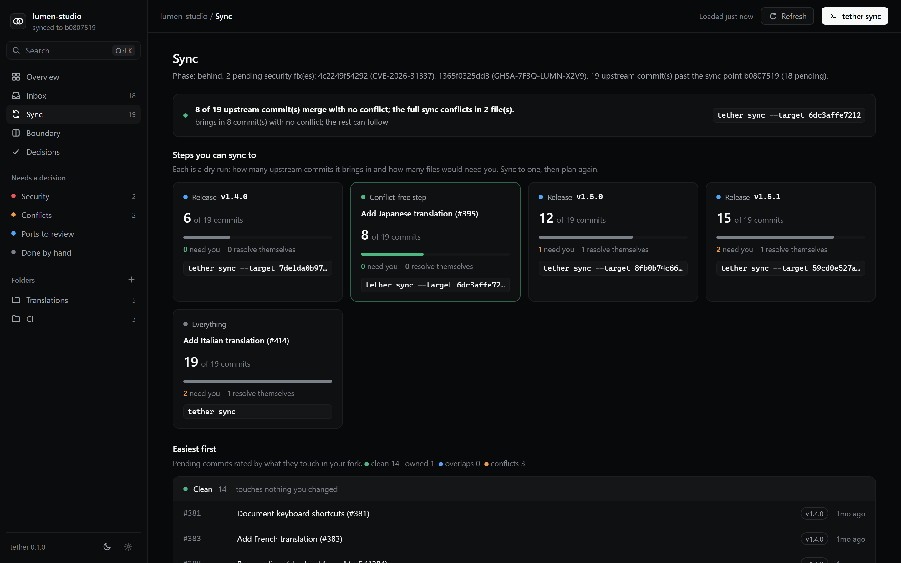
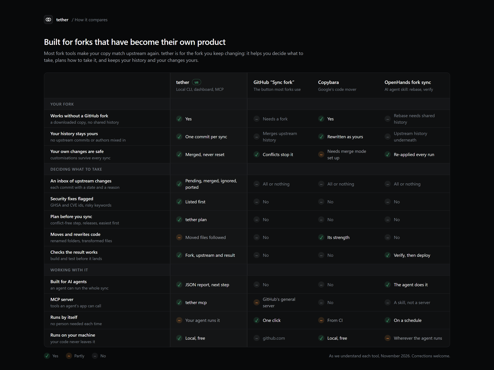

# tether

**Keep your fork in step with the project it came from, without letting
upstream's history take over yours.**

You built a product on top of an open-source project. Upstream keeps shipping
fixes, translations, security patches and features, and your fork keeps
drifting. Every catch-up is a guessing game: what's new, what's safe, what
will clash with your own changes, and what did you decide last time?

tether answers those questions. It's a small, local command-line tool built
for AI coding agents first and people second. Every command answers in the
same JSON shape and always says what to do next, so an agent can run a whole
sync on its own and stop when a person needs to decide something.



<sub>Screenshots show a made-up fork, "Lumen Studio", built on an imaginary
upstream, "Lumen". Build it yourself with `scripts/demo-fork.sh`.</sub>

## What it does

**Shows you what upstream changed, as an inbox.** Every upstream commit since
your last sync, with its state (pending, merged, ignored, ported by hand), the
release that first shipped it, and any security references (GHSA and CVE ids,
or words like "XSS"). Security fixes come first.



**Plans the sync before you start.** `tether plan` does dry runs along
upstream's history. It finds the furthest point you can sync to with no
conflict at all, previews each upstream release in range, and sorts the
waiting commits from easiest to hardest by what they touch in your fork:

- **Clean:** touches nothing you changed.
- **Owned:** touches only areas your fork owns, which resolve themselves.
- **Overlap:** touches files you changed, but merges cleanly.
- **Conflict:** needs a person.

Take the easy part now and the hard part later.



**Lands each sync as one clean commit.** Upstream comes in as a single
squashed commit on your side, with an `Upstream-Synced: <sha>` line recording
how far you have taken it. None of upstream's commits or authors appear in
your history. It works even if you downloaded the project instead of forking
it, with no shared history at all.

**Gives agents a work packet per change.** For one upstream commit, `tether
packet` prints the diff, why it was made, where it lands in your code (even
after you moved files around), and how to record what you decided.

**Keeps decisions next to the code.** Take, skip or adapt each change, with
the reason and the evidence saved in `.tether/`. They're checked into your
repo, so the next sync and your CI see them too.

**Verifies three ways.** When the result fails to build or test, tether also
checks your fork as it was and upstream as it shipped, so you know whose test
broke. Only failures that are new in the result block the sync.

**Maps where you differ.** `tether map` generates a divergence map from short
`// tether: <why>` comments in your code. You never maintain it by hand, and
`tether check` flags changes with no explanation.

**Lets you sort upstream your own way.** File commits into folders like
"Translations" or "CI" so the inbox reads the way you think. Folders are only
a reading aid and never change what a sync does.

**Guards it all in CI.** `tether check` is one gate for size budgets, stray
changes, owned areas, drift, ports and reviews.

## How it compares

The right tool depends on the fork you have. The table groups what people need
by situation, and compares tether with what people in each situation use
today: plain git, GitHub's Sync fork,
[Copybara](https://github.com/google/copybara), and AI agents that rebase on a
schedule, such as OpenHands'
[upstream fork sync](https://www.skills.sh/openhands/extensions/upstream-fork-sync).



In short:

- **A few small patches, or a mirror:** use git or GitHub's button. They're
  quicker, and tether would be more setup than you need.
- **Moving or rewriting code between repositories:** use Copybara.
- **A fork near upstream that should sync itself:** a scheduled agent rebase
  fits well.
- **A product built from upstream, kept for years:** this is tether's case.
  Use it when the fork started from a copy, moved or rewrote upstream's files,
  must never silently lose an upstream fix, or is kept up by an agent with a
  person making the key calls.

Spotted something wrong? Open an issue. The table's source is
[docs/compare/compare.html](docs/compare/compare.html).

## Try it

```sh
cargo install --git https://github.com/Punit-Dethe/tether
cd your-fork
git remote add upstream <url-of-the-original-project>   # if not already there
tether doctor
tether init --sync-point <last-upstream-commit-you-have>
tether status
```

`tether status` always ends with the single next thing to do.

To look around first, build the demo fork from the screenshots and open the
dashboard:

```sh
scripts/demo-fork.sh /tmp/tether-demo
cd /tmp/tether-demo/lumen-studio
tether ui
```

## Three ways to use it

**1. From the command line** (people, or agents with a shell)

| Command | What it does |
| --- | --- |
| `status` | Where things stand, and the one thing to do next |
| `inbox` | Upstream commits and their state (`--all`, `--security`) |
| `plan` | The conflict-free step, each release, and commits easiest first |
| `packet <item>` | Everything needed to act on one upstream commit |
| `sync` | Bring upstream in (`--dry-run`, `--target`, `--continue`, `--abort`) |
| `decide <item> …` | Record merged, ignored, ported or adapted, with evidence |
| `verify` | Build and test the result against the fork and upstream |
| `map` | The divergence map from `tether:` comments |
| `folder` | Group commits into folders of your own |
| `check` | The CI gate |
| `closeout <rev>` | Move the sync point over fully decided commits |
| `doctor` | Check git and the repository, in plain words |
| `ui` | Open the local dashboard |
| `mcp` | Serve the commands as MCP tools |

Add `--json` to any command for the machine-readable report. Items are a
commit sha prefix or a PR number like `#412`.

**2. In the browser.** `tether ui` opens the dashboard in the screenshots
above. It listens only on your own machine, refuses requests from other
sites, and changes nothing except your folders.

**3. As an MCP server** (agents without a shell). Many agent apps can't run
commands but do speak the Model Context Protocol. Add tether once, and the app
starts `tether mcp` in the background when a session opens and stops it when
the session ends. There's nothing to keep running yourself. With Claude Code:

```sh
claude mcp add tether -- tether mcp                  # read-only
claude mcp add tether -- tether mcp --allow-writes   # can also sync and decide
```

Other apps take the same command in their MCP settings:
`"command": "tether", "args": ["mcp"]`. Run it in the fork, or add
`-C <path-to-fork>` before `mcp`.

| Always available (read-only) | Only with `--allow-writes` |
| --- | --- |
| `status`, `inbox`, `plan`, `packet`, `sync_preview`, `map`, `check`, `doctor`, `folder` | `decide`, `sync`, `verify`, `closeout` |

Only a person can turn writes on, because the flag lives in the app's
settings. Every tool call counts as an agent's, so your fork's rules about what
needs a person (below) still apply.

## Built for agents

Every command returns the same envelope, so an agent can always read `ok`,
`error.code` and `next` without knowing which command it ran:

```json
{
  "tether": "0.1.0",
  "command": "status",
  "ok": true,
  "summary": "2 pending security fix(es). 19 upstream commit(s) past the sync point.",
  "data": { "phase": "behind", "behind": 19 },
  "next": { "command": "tether sync", "why": "...", "kind": "run" },
  "error": null
}
```

- **`next.kind`** says how to treat `next.command`. `run` means run it as
  written, `edit` means fix files first, `decide` means fill in a decision, and
  `ask_human` means stop and ask.
- **Exit codes:** `0` done, `1` failed (see `error.code`), `2` worked but
  something needs action (see `next`). Branch on `error.code`, never on
  message text.
- **What needs a person** is your call: list actions such as `skip-verify`,
  `sync-unreleased` or `ignored` under `[agent] needs_human` in
  `.tether/config.toml`. An agent then gets `needs_human` instead of the
  action happening.

[AGENT.md](AGENT.md) is the guide to hand your agent: it can run a whole sync
by following `tether status` alone.

## Status

Early, but used for real. tether runs the upstream sync for
[Grain](https://github.com/Punit-Dethe/Grain), a product fork of
[Handy](https://github.com/cjpais/Handy). On that history it matches the
Python tooling it replaced: 299 tracked commits, a 72-commit sync with 13
conflicts, 42 size budgets, the port audit and the review gate. The roadmap is
in [docs/PLAN.md](docs/PLAN.md).

**Planned: several upstreams in one repository.** Today tether tracks one
upstream per repository. Some products are built from more than one project,
for example an app forked from one project with a library forked from another
vendored inside it. Support for that is planned: each upstream would get its
own sync point, inbox, plan and decisions, all from the same repository.

## Licence

MIT. See [LICENSE](LICENSE).
